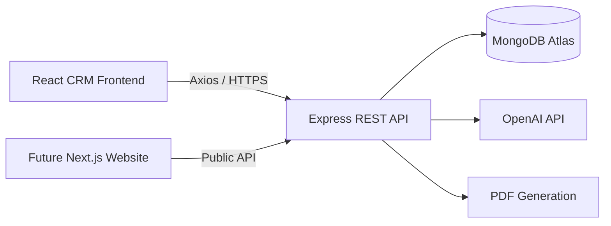

<div align="center">

# 🌴 Dream Ceylon CRM

### A modern MERN-stack CRM for Sri Lankan Destination Management Companies

<p>
  Manage inquiries, customers, quotations, bookings, payments, follow-ups, vehicles, PDFs, AI tools, analytics, and administrator permissions from one platform.
</p>

<p>
  
  
  <a href="https://github.com/janithcd/dream-ceylon-crm-mern/actions/workflows/ci.yml"></a>
  
</p>

<p>
  
  
  
  
  
  
</p>

</div>

---

## ✨ Overview

**Dream Ceylon CRM** is a full-stack travel operations and customer relationship management platform developed for **Dream Ceylon Journeys**, a Sri Lankan Destination Management Company.

It supports the complete customer journey:

```text
Inquiry → Follow-Up → Quotation → Booking → Payment → Reports
```

The system combines operational management, AI-powered productivity tools, branded PDF generation, analytics, role-based access control, and public APIs for a future Next.js tourism website.

---

## 🚀 Key Features

### 👥 Customer and Sales Management

- Capture and manage customer inquiries
- Staff can add a manual inquiry with its real source and priority; public website submissions remain tagged Website and cannot set private sales fields. When closing an inquiry as Cancelled, choose a loss reason and optionally add a private note (up to 300 characters). Reopening or converting it clears those fields. Older closed inquiries without reasons remain editable and appear as Unspecified in reports.
- **Lead Insights** compares Website, social, referral, and other inquiry sources over the last 30, 90, or 365 Sri Lanka calendar days, or all time. Each period groups inquiries by creation date; a lead counts as booked only if it has a linked booking, including a booking later cancelled. Closing an unbooked lead counts as lost. The page shows conversion rates and loss reasons without guest details. First-contact metrics show the number with a valid recorded contact, average elapsed response hours, the share contacted within 24 hours, and still-New inquiries waiting 24 hours or more with no recorded contact. Only first contacts actually logged in the CRM are counted; manually changing status does not supply a contact time. Older records with missing or invalid contact times show no response metric. Bookings and first contacts may occur after the inquiry period, so these are current cohort results rather than events made during that period. `GET /api/inquiries/insights?window=30|90|365|all` requires `inquiry.view`; manual entry at `POST /api/inquiries/manual` requires `inquiry.create`. The public `POST /api/inquiries` remains available with rate limiting and resets submitted source, status, priority and internal fields.
- **New Lead Queue** lists New inquiries oldest first, with filters for all, unassigned, and mine. Staff with `inquiry.update` can assign an active admin who also has that permission; inactive or read-only admins cannot own new leads. The same owner control appears on open inquiries in the main list. Once the guest has actually been contacted, choose Email, WhatsApp, Phone, or Other and select **Record contact**. This stores the time, channel and staff member, changes a still-New inquiry to Contacted, and assigns an unowned lead to that staff member. It does not send a message. Reopening an inquiry keeps its first contact record; a later recorded contact appears in activity history without replacing the original. Older inquiries with no owner or first contact remain valid. `GET /api/inquiries/triage?filter=all|unassigned|mine&page=1` requires `inquiry.view`; `GET /api/inquiries/assignees`, `PATCH /api/inquiries/:id/assignee` (`{ assignedTo: id|null }`) and `PATCH /api/inquiries/:id/contacted` (`{ channel }`) require `inquiry.update`.
- Search, filter, update, and delete inquiries
- Build complete customer profiles
- View inquiry, quotation, booking, and payment history
- Schedule and complete customer follow-ups
- Identify overdue and upcoming follow-ups
- **Follow-up ownership:** new reminders default to their creator; staff can assign an active admin with `followUp.manage` or leave one unassigned. The follow-up page offers owner filters and one-click **My due work** and **Unassigned due work** queues. Due means pending with a date on or before today in Sri Lanka. The dashboard shows only your and unassigned reminders, with the owner displayed next to each; the main list can still show all team reminders. Existing reminders without an owner remain unassigned. Summary cards follow the selected owner filter. `GET /api/follow-ups?owner=all|mine|unassigned|attention|<adminId>&dateFilter=due` and `/summary?owner=...` require `followUp.view`; `/assignees` lists active eligible staff. Follow-up writes require `followUp.manage`.
- See a header alert for new unassigned inquiries and new inquiries assigned to you; it highlights those waiting at least 24 hours and links to the lead queue. The alert refreshes after inquiry changes, on focus, and every minute while the CRM is open.
- Open a reviewed WhatsApp message from a pending follow-up (requires an international client number; the admin sends it manually)
- Export business data to CSV

### 🧾 Quotations and Bookings

- Create professional travel quotations
- Generate branded quotation PDFs
- Set an optional **Valid until** date on quotations. It appears on the client PDF, in quotation history, and in CSV exports. In **Quotation History → Offer validity**, find sent offers past their validity date, ending within seven Sri Lanka calendar days, or missing a date. An expired date is flagged for a rate review but does not silently change the quotation's status or prevent a client from accepting it. Edit or clear the date when revising an offer. Saved quotation PDF downloads retain the saved quotation number and creation date; unsaved previews use a temporary number and current date.
- From **Quotation History**, use **Create revised draft** to copy an unconverted offer into a separate draft with a new quotation number. Prices, itinerary details, inclusions, exclusions, and internal notes are copied; the client and inquiry link are retained. The booking link and validity date are cleared, and the original offer's status and prices stay as saved. The new record shows its source quotation number even if the source is later deleted. Edit the new draft, check current rates, set a fresh validity date, then send its PDF. Requires `quotation.view` and `quotation.create`; converted quotations must be amended through their booking instead. `POST /api/quotations/:id/revisions` creates the new draft and ignores client-supplied fields.
- For a revised quotation, choose **Compare with previous quotation** in Quotation History to see the source and revised offer side by side. Changed dates, terms, transport and prices are highlighted; **Only changes** hides identical fields. The comparison reads both saved quotations when opened, so it reflects later edits to either record. It displays different currencies as recorded without converting them. If the source was deleted, its saved number remains visible, but comparison is unavailable.
- Convert accepted quotations into bookings
- Manage booking details and status
- Open **Bookings → Readiness review** on an active booking to check the latest saved guest details, itinerary day coverage, hotel night coverage, transport confirmations and pickup details, and open/overdue/unassigned preparation tasks. Each area links to its existing editor. Empty plans show **Not assessed** rather than a pass; hotels may be guest-arranged, and overlapping stays may be intentional. Flight and pickup times remain separate. The review uses Sri Lanka calendar dates, excludes financial checks, and does not change any booking, task, or contact record. Reopen or refresh it after saving changes; completed/cancelled bookings are not assessed.
- Plan a dated, day-by-day itinerary for each booking, including activities and overnight locations; entries appear in the internal operations brief, and trip dates cannot exclude planned entries
- Preview and import the selected tour package's day plan into an empty booking itinerary, starting on a chosen trip date; personalize imported entries before sharing
- Download a branded guest itinerary PDF from the booking itinerary planner; it uses saved trip entries and company contact details, marks pending bookings as drafts, and leaves out financial and private supplier information
- Track an internal preparation checklist per booking for hotels, transport, guides, itineraries, or custom tasks; assign active staff, optional due dates, task priorities, and private handoff notes
- In **Bookings → Preparation**, choose relevant starter tasks and add them together. Suggested dates are 21 days before departure for accommodation, 14 for transport and guides, and three for the final guest itinerary; dates never begin before the current Sri Lanka day. Turn off suggested dates to leave them open, then assign owners and adjust each task. Existing titles are skipped and the 30-task limit still applies.
- Record hotel stays, room and meal plans, confirmation status, and hotel references on each booking
- Save an optional hotel cancellation cutoff date and the supplier's terms on each stay. **Hotel Deadlines** lists active bookings with an upcoming check-in and a saved cutoff, including requested and confirmed stays. Its due-soon view includes passed cutoffs, today, and the next six Sri Lanka calendar days; cancelled stays and past check-ins leave the queue. The **Suppliers** header alert includes these due-soon cutoffs and refreshes after hotel edits, when the CRM regains focus, and every five minutes. A date is only a reminder: check the exact cutoff time, charges, and written terms with the hotel. `GET /api/bookings/hotel-cancellation-deadlines` requires `booking.view`, accepts `filter=due7|overdue|later|all` and `page`, and returns 25 stays per page without guest contact or supplier cost details.
- **Cancellation Review** lists cancelled bookings with requested or confirmed hotel stays or transport legs that still need supplier follow-up. Review each arrangement and record its individual cancellation after contacting the supplier. The All cancelled trips view retains trips after arrangements are closed. Finance and Super Admin also see booked paid totals, recorded receipts and refunds, and recorded supplier costs by currency; these figures are review context, not an automatic cancellation charge or refund entitlement. The queue omits financial fields for staff without both `payment.view` and `cost.view`. `GET /api/bookings/cancellation-review?filter=open|all&page=1` requires `booking.view`, returns 20 bookings per page, and uses `Cache-Control: no-store`.
- When a booking enters **Cancelled**, enter a 10–300 character reason. The CRM records the staff member and time, shows the details in Cancellation Review, and adds the reason to booking history. A cancelled booking can still be edited without replacing its saved reason; older cancellations with no reason are labelled as such. Reopening clears the current cancellation fields, while the earlier reason remains in activity history. These status changes do not cancel hotel/transport arrangements or decide financial settlements.
- From **Cancellation Review** or **Bookings → Hotels**, staff with booking edit access can prepare an editable hotel cancellation email for an open stay on a cancelled trip. It uses the saved dates, room count, lead guest and any hotel reference, asks for written confirmation and the basis of any charges, and leaves out the private cancellation reason, supplier costs and guest contact details. Copy it or open an email app to send manually. Drafting does not send an email, log contact, or mark the hotel stay cancelled; update the stay after the supplier responds. `GET /api/bookings/:id/hotel-stays/:stayId/cancellation-draft` requires `booking.view` and `booking.update`, rechecks the booking and stay, and disables caching.
- Save an optional supplier email on each hotel stay. For a requested stay, use **Supplier Confirmations → Prepare email** or **Bookings → Hotels → Prepare email** to review an editable confirmation request with the latest saved dates, guest name, room count, room type and meal plan. Copy the details or open your email app to send it manually. Missing supplier email or room details are highlighted; financial details, guest contact information and internal notes are excluded. Drafting does not log supplier contact or confirm the stay. Once the supplier replies, record its confirmation status and reference in Hotels. The draft requires both `booking.view` and `booking.update` and is available at `GET /api/bookings/:id/hotel-stays/:stayId/confirmation-draft` for active bookings with requested stays.
- Log a supplier email, WhatsApp message, or phone call from **Supplier Confirmations** or the booking's **Hotels** and **Transport** details. The service history records who made contact, when, the channel, a private note, and the next follow-up date. Logging updates the queue's follow-up date and shows the latest contact there; it does not send a message or confirm the supplier. Leave the next date blank to clear a reminder. Dates must be today or later and no later than check-in or the transport start (Sri Lanka time). Up to 50 recent contacts per service are kept. Staff with `booking.view` can read the history; logging needs both `booking.view` and `booking.update`, an active booking, and a requested service. Use `GET` and `POST /api/bookings/:id/supplier-contacts/:type/:itemId`, where `type` is `hotel` or `transport`. The queue and booking activity log exclude private contact notes.
- Download a branded hotel voucher from each confirmed stay in **Bookings → Hotels**. It includes the lead guest, property, check-in/out dates, nights, rooms, meal plan, hotel reference, and company contact details. Missing optional details are labelled “Not supplied”; supplier prices, payments, guest contact details, and internal notes are excluded. The voucher is not a payment receipt. Cancelled stays/bookings cannot generate vouchers, and each download is recorded in booking history.
- Review hotel night coverage in each booking to spot missing nights, reservations awaiting confirmation, overlapping stays, and stays outside the trip dates
- Plan multiple transport legs per booking with vehicle registration, chauffeur, pickup details, and status; flag possible date overlaps for the same confirmed vehicle
- Attach arrival or departure flight numbers, scheduled dates and times, airports, and terminals to transfers; keep pickup time separate and include flight details in the chauffeur operations PDF (Sri Lanka time)
- Use **Airport Transfers** to review pickups across active bookings, filter arrivals/departures or missing chauffeurs, and open transport details directly; the next seven days are shown by default, with date ranges up to 31 days. The schedule uses each transport leg’s start date as its pickup date, shows flight times separately, and includes requested/confirmed legs with saved flight details. Cancelled transfers and completed/cancelled bookings are excluded. All times are in Sri Lanka time.
- Prepare a **Guest message** from a confirmed airport transfer. The CRM reloads saved pickup, flight, chauffeur, and vehicle details into an editable WhatsApp draft, highlights missing details, and lets staff copy the text or open WhatsApp with a reviewed international recipient number. Private notes and financial information are excluded. Staff send the message themselves; drafting or opening WhatsApp does not log contact, mark a message sent, or change the booking.
- Download a private departure handover PDF with guest contact, active hotels, transport, and open tasks; prices and private notes are excluded
- Open a booking history to see dated staff actions across its details, preparation tasks, hotel stays, and PDFs; payment events require payment access and supplier cost changes require cost access
- View bookings in a calendar
- Generate booking invoices and receipts
- Track outstanding balances
- Set an optional payment due date when creating or editing a booking; Finance can update it from Outstanding Balances
- Log actual payment contact and schedule the next follow-up from Outstanding Balances
- Record private supplier costs and compare estimated quotation profit with booked profit

### 💳 Payments and Finance

- Record booking payments
- View payment history
- Handle refunds
- Match recorded guest receipts and refunds against bank or cashbook entries
- Calculate paid, pending, and outstanding amounts
- Generate individual payment receipts
- View financial reports
- Keep cost entries visible only to admins with cost permissions
- Export report data

The **Outstanding Balances** page lists open balances by agreed payment due date, with filters for overdue dates, the next seven days, later dates, and bookings without a due date. Departure filters can be combined with payment timing. Existing bookings have no due date until staff records one; a departure date alone is not treated as a payment deadline. Payment dates use Sri Lanka calendar days, and recording a payment removes a fully paid booking from this queue.

In **Payment Reports → Guest payment matching**, Finance can review recorded receipts and refunds for a Sri Lanka date range (up to 366 days), search payment or statement references, and filter **To match** or **Matched**. Enter the bank statement or cashbook reference to match a payment; reopen an incorrect match with a reason. Each change records the staff member, time, reference and a snapshot of the amount, currency and status. Matched payments must be reopened before editing or deleting them. Matching never changes the paid balance, and cancelled payments do not appear in this register. Existing payments start as unmatched. The register totals received, refunded and net separately by currency, pages 25 records at a time, and exports up to 10,000 matching records to CSV. `GET /api/booking-payments/register` requires `payment.view` and `report.view`; `/register/export` also requires `report.export`. `PATCH /api/booking-payments/:id/reconciliation` requires `payment.view` and `payment.reconcile` with `{ "reconciled": true, "statementReference": "..." }` or `{ "reconciled": false, "reason": "..." }`. Finance and Super Admin have the new reconcile permission by default; a Super Admin can grant it to others.

Use **Correct payment** in the matching register for an unmatched record after checking its bank entry or cashbook entry. Finance can correct the booking-currency amount, Sri Lanka payment date, receipt/refund direction and type, method and reference. Older refund type/status mismatches and currency mismatches are highlighted. A currency correction needs a verified converted amount; the CRM does not calculate exchange rates. A matched payment must first be reopened with a reason. Every `PUT /api/booking-payments/:id` edit now needs `correctionReason` (3–300 characters) and an actual detail change; the activity log stores the old and new payment details, changed fields and reason without including private payment notes. Changing or editing a refund needs both `payment.update` and `payment.refund`. Payment dates cannot be corrected into the future. The balance is recalculated after a correction, and a guest statement can be issued once all booking ledger inconsistencies are resolved. Cancelled entries remain outside the matching register.

Payment Reports keeps received, refunded, net, and cancelled amounts separate by currency when viewing all payments. Select one currency to see its summary cards and monetary charts; the status chart still counts records across the current filters. Payment date filters and month groupings use Sri Lanka calendar days. The API returns `summaryByCurrency` for all views, and returns a single `summary` plus amount charts only when `currency` is selected. Invalid dates or page sizes return 400.

Record guest payments and refunds in the **booking currency**. If a bank transfer arrives in another currency, calculate the agreed booking-currency amount first and note the original amount and rate; the CRM does not fetch or apply exchange rates. The API rejects a different payment currency on create or edit. Once a booking has a paid amount or any payment record, its currency is locked. After payment records exist, booking edits cannot overwrite the paid amount or payment status from a stale form. Older payments whose currency differs from their booking are highlighted in Payment Reports, the matching register, and booking payment history. They cannot be newly matched to a bank entry, and recalculating a booking balance excludes their different-currency amounts. Finance can use **Correct payment** in the matching register to enter the verified booking-currency amount and an audit reason; a previously matched payment must be reopened first. The correction updates the guest balance, and the activity log retains the old amount and currency. Editing a refund also requires `payment.refund`, even when changing only its amount. Review the bank entry and agreed conversion before correcting; no automatic conversion is performed.

Refunds are separate records with type **Refund** and status **Refunded**; a cancelled refund does not change the guest balance. The payment form shows the net amount of recorded receipts still available to refund. The API rejects refunds above that amount, mismatched refund type/status, and edits or deletions of receipts that would leave refunds greater than receipts. Each amount uses at most two decimals. Existing negative balances from older data may be reduced, but changes cannot deepen the deficit. Only records in the booking currency count toward the refundable amount; bank-matched records still require reopening before editing or deletion.

Payment creates, edits, and deletions are serialized per booking across API processes while refund availability and the booking balance are checked. Simultaneous refunds cannot both consume the same available amount. A booking write lease expires after a failed process; a request waiting more than five seconds returns a conflict and can be retried.

The payment history downloads a payment receipt for recorded receipts and a **refund confirmation** for refunds. Refund confirmations say the money was refunded to the guest and use a distinct filename and audit label. Cancelled entries cannot generate a payment document. Older entries with conflicting payment type and status need correction before a document can be generated. PDFs are returned with `Cache-Control: no-store`.

In **Bookings → Payments**, staff with booking view, payment view and PDF permission can download a **guest payment statement**. It shows the booking price, received payments, refunds, net paid, any guest credit, remaining balance and the hotel advance target with due dates. Its dated history includes payment numbers, methods and references, but excludes cancelled entries, supplier costs and internal notes. All amounts use the booking currency. The PDF stops with a review message if older foreign-currency, mismatched refund, negative balance, future-dated or unitemized paid amounts would make the statement inaccurate. `POST /api/booking-pdf/payment-statement/:id` requires `booking.view`, `payment.view` and `pdf.generate`; downloads are logged and not cached.

The payment modal checks **statement readiness** when it opens or refreshes. It lists each affected payment number and a short next step for mismatched receipt/refund directions, different currencies, invalid amounts or dates, and future-dated records. Booking-level issues cover a cancelled booking, invalid price or hotel advance, refunds above receipts, and a paid total that does not match the ledger. Dated payment issues link to the matching register with that date and payment number selected for Finance. The download button remains unavailable while a review is required or the check cannot be completed. `GET /api/booking-pdf/payment-statement/:id/readiness` requires `booking.view` and `payment.view`, returns `{ ready, issues, checkedAt }`, and is not cached. The PDF repeats the same validation under a booking payment lock when it is generated, so a later change cannot rely on an earlier readiness result.

For an older booking whose **paid amount differs from its payment history**, the payment modal shows both totals. Verify every historical receipt and refund against the bank or cashbook before issuing a statement. Adding a payment recalculates the booking paid amount from the full recorded history, so enter all verified missing entries with their actual dates and references. If the payment history is complete and the booking summary is stale, Finance can select **Reconcile from complete ledger**, enter an audit reason and confirm that all entries were checked. This changes the booking paid total and status to the validated ledger result without creating a payment; it can reduce an unitemized opening amount to zero. `POST /api/booking-payments/booking/:bookingId/reconcile-summary` requires `booking.view`, `payment.view`, `payment.update` and `payment.reconcile`, plus the reviewed booked/ledger/target amounts, `confirmLedgerComplete: true`, and a 10–300 character reason. It rejects other statement issues, stale totals, and concurrent changes. The correction and reason are recorded in the activity log.

For packages requiring a hotel deposit, set a **hotel advance to collect** in the booking currency and its due date (for example, the agreed 50% of hotel charges), followed by the existing final balance due date. The CRM does not infer this amount from supplier costs, which may use different currencies. The hotel advance is a collection target, not money received; only payment records change the paid total. The payment modal shows both milestone targets and outstanding amounts. Net payments cover the hotel advance first, and a refund can reopen it. Outstanding Balances, due filters, header alerts, and reviewed WhatsApp reminders use the next unpaid milestone; older bookings without an advance continue to use their existing balance due date. Staff with `payment.update` can change the advance at `PATCH /api/bookings/:id/hotel-advance` with `{ "hotelAdvanceAmount": 300, "hotelAdvanceDueDate": "YYYY-MM-DD" }` (send `0` and `null` to clear). The advance cannot exceed the booking price, and its date cannot fall after the final due date.

Admins who can record payments can prepare a WhatsApp reminder from an open balance. The CRM reloads the booking before drafting, calculates the remaining amount, and shows the recipient and message for review. Opening WhatsApp does not send the message or mark the booking as contacted.

After reaching the guest by WhatsApp, phone, email, or another channel, staff with `payment.update` can use **Log contact** to record the time and an optional next follow-up date. **Follow-ups due** shows open balances with a follow-up scheduled for today or earlier in Sri Lanka; it combines with the payment and departure filters. Logging a new contact replaces the current follow-up date, while booking history retains previous contact entries for staff with `payment.view`. A fully paid or cancelled booking cannot be logged from the balance queue.

Admins with booking and payment view access see a **Payments** alert in the header for open balances whose payment date is overdue or whose scheduled contact follow-up is due. A booking with both conditions counts once in the badge. The panel shows five bookings and links to the relevant filtered queue. It refreshes after payment changes, when the CRM regains focus, and every five minutes; it does not send messages or emails.

The **Cost & Profit** page is available to Super Admin and Finance accounts. Open a quotation to enter *estimated* supplier costs, or a booking to enter *actual* supplier costs. Cost entries are stored separately from client quotations and invoices, and require `cost.view` to read or `cost.manage` to change. A Super Admin can grant these permissions to another admin. Costs never appear in customer PDFs.

Enter each supplier amount in its own currency. If it differs from the quotation or booking currency, enter the rate as **one supplier currency unit in the selling currency**. For example, if the client price is in USD and one LKR is worth 0.0033 USD, enter `0.0033` for an LKR cost. This rate is saved on the entry; the CRM does not fetch live exchange rates. Changing a sale currency flags old costs for review and hides profit until they are revalued. The summary uses `profit = client selling price − recorded costs` and `margin = profit / client selling price`. No profit is shown before any costs are entered. Booking profit uses the full booked selling price, while actual cash received and refunds remain in Payment Reports.

For **actual booking costs**, enter an optional supplier payment due date, then use **Payments** on a saved cost to record each deposit with its Sri Lanka payment date, method, optional reference and note. The history records the staff member and time; previous paid totals remain as unitemized opening balances. Use **Correct paid total** only for adjustments, which are also recorded in history. Staff with `cost.view` can read the history; `cost.manage` is required to record a payment at `POST /api/finance/costs/:id/payments`. Payments cannot exceed the remaining amount, be dated in the future, or be recorded on quotation estimates. A cost with recorded payments cannot be deleted or changed to another currency; reconcile the history with bank records. Cost and payment actions appear in booking activity without exposing private supplier amounts there.

The cost table shows what remains in each supplier's currency; it never adds different currencies together. The booking tab has a paged **Supplier payment schedule** with filters for overdue, due soon (overdue plus today through the next six Sri Lanka calendar days), later, no due date, and all unpaid costs. It shows the filtered remaining total separately by currency, 25 costs per page, and links to the booking. Costs without dates do not appear in the header alert; set a date so Finance can plan payment. `GET /api/finance/costs/schedule` requires `cost.view` and accepts `filter`, `page`, and `limit` (up to 50). The header's **Supplier dues** alert remains limited to overdue and due soon, up to 50 earliest entries, and refreshes after cost and payment edits, when the CRM regains focus, every five minutes, or manually. Fully paid costs leave the schedule. Bookings with supplier payments or correction history cannot be deleted; cancel the booking to preserve its payment record.

The booking tab also has a **Supplier payment register** for matching recorded deposits to bank records. Filter by inclusive payment dates (Sri Lanka calendar, up to 366 days) and a case-insensitive payment reference, then open the linked booking or export all matching payments as CSV. The default view is the current Sri Lanka month, with 25 payments per page and separate totals for each supplier currency. Unitemized opening balances and manual paid total corrections are excluded because they are not individual cash payments. `GET /api/finance/costs/payment-register` requires `cost.view`; `/payment-register/export` additionally requires `report.export` and allows up to 10,000 matching rows per download. Narrow the filter for larger exports.

Finance staff can filter the register to **To match** or **Matched**, enter a bank statement or cashbook reference to reconcile each payment, and reopen a mistaken match with a required reason. These actions require `cost.view` and `cost.manage` at `PATCH /api/finance/costs/:id/payments/:paymentId/reconciliation` (`{ reconciled: true, statementReference }` or `{ reconciled: false, reason }`). The payment amount and paid total do not change. The register, booking payment history, and CSV show current status; reconciliation events retain the staff member, time, previous reference, and reopening reason. Older payments start unmatched until reviewed. CSV exports respect the selected status filter.

### 🤖 AI Tools

- Generate client replies
- Generate travel itineraries
- Create professional itinerary content
- Improve response quality and speed
- Support configurable OpenAI models

### 🚐 DMC Operations

- Manage destinations
- Manage tour packages
- Manage vehicles
- Configure company information
- Configure PDF branding and payment instructions
- Connect the CRM with a future public website

### 📊 Analytics and Monitoring

- Dashboard statistics
- Upcoming departures for the next 30 days, with shortcuts to each booking
- Bookings needing attention for upcoming departures with requested hotel stays, unfinished preparation tasks, and overdue task counts
- My Tasks view for each admin's assigned preparation work, with due-date and high-priority filters and quick completion
- Team Tasks view for open work across active bookings, including unassigned tasks and safe self-assignment
- Header alerts for assigned tasks due today or overdue, updated after checklist changes and while the CRM is open
- Revenue and booking charts
- Recent activity panel
- Follow-up alerts
- Searchable activity logs
- Administrator action tracking

### 🔐 Security and Administration

- JWT authentication
- Password hashing with bcrypt
- Email code password recovery with one-time reset and session revocation
- Backend permission enforcement
- Frontend route and action guards
- Administrator account activation
- Custom permissions
- Login rate limiting
- Public inquiry rate limiting
- Helmet security headers
- Configurable production CORS
- Environment validation
- Safe production error handling

---

## 🛡️ Administrator Roles

| Role | Main Access |
|---|---|
| 👑 **Super Admin** | Complete system and administrator control |
| 🧭 **Manager** | Business operations and management |
| 💼 **Sales** | Inquiries, quotations, bookings, and follow-ups |
| 💰 **Finance** | Payments, refunds, and financial reports |
| 👁️ **Viewer** | Read-only operational access |

Custom permissions can be added to individual administrator accounts.

---

## 🧰 Technology Stack

<div align="center">

<table>
<tr>
<td align="center" width="110">
<br/>
<b>Node.js</b>
</td>
<td align="center" width="110">
<br/>
<b>Express</b>
</td>
<td align="center" width="110">
<br/>
<b>MongoDB</b>
</td>
<td align="center" width="110">
<br/>
<b>React</b>
</td>
<td align="center" width="110">
<br/>
<b>Vite</b>
</td>
<td align="center" width="110">
<br/>
<b>Bootstrap</b>
</td>
</tr>
<tr>
<td align="center" width="110">
<br/>
<b>JavaScript</b>
</td>
<td align="center" width="110">
<br/>
<b>Git</b>
</td>
<td align="center" width="110">
<br/>
<b>GitHub</b>
</td>
<td align="center" width="110">
<br/>
<b>Postman</b>
</td>
<td align="center" width="110">
<br/>
<b>HTML5</b>
</td>
<td align="center" width="110">
<br/>
<b>CSS3</b>
</td>
</tr>
</table>

</div>

### Backend

- Node.js
- Express.js
- MongoDB Atlas
- Mongoose
- JSON Web Tokens
- bcryptjs
- OpenAI API
- pdf-lib
- Helmet
- Express Rate Limit
- CORS
- dotenv

### Frontend

- React
- Vite
- React Router DOM
- Axios
- Bootstrap
- React Icons
- Recharts

---

## 🏗️ System Architecture



---

## 📂 Project Structure

```text
dream-ceylon-crm/
│
├── backend/
│   ├── assets/
│   ├── config/
│   ├── controllers/
│   ├── middleware/
│   ├── models/
│   ├── routes/
│   ├── scripts/
│   ├── utils/
│   ├── .env.example
│   ├── package.json
│   └── server.js
│
├── frontend/
│   ├── public/
│   ├── src/
│   │   ├── api/
│   │   ├── components/
│   │   ├── config/
│   │   ├── context/
│   │   ├── layouts/
│   │   └── pages/
│   ├── .env.example
│   └── package.json
│
├── docs/
│   ├── API_DOCUMENTATION.md
│   ├── DEPLOYMENT_GUIDE.md
│   ├── PROJECT_FEATURES.md
│   ├── PRODUCTION_CHECKLIST.md
│   └── SECURITY.md
│
├── postman/
├── README.md
└── SECURITY.md
```

---

## ⚙️ Local Installation

### 1️⃣ Clone the Repository

```bash
git clone YOUR_REPOSITORY_URL
cd dream-ceylon-crm
```

### 2️⃣ Install Backend Dependencies

```bash
cd backend
npm install
```

Create the backend environment file:

```bash
copy .env.example .env
```

Configure:

```env
NODE_ENV=development
PORT=5000

MONGO_URI=your_mongodb_connection_string

JWT_SECRET=your_long_random_jwt_secret
JWT_EXPIRES_IN=30d

OPENAI_API_KEY=your_openai_api_key
OPENAI_MODEL=your_model_name

CLIENT_URL=http://localhost:5173
CLIENT_URLS=http://localhost:5173

# Zoho CPaaS transactional email Agent
ZOHO_CPaaS_API_KEY=your_send_api_key
ZOHO_CPaaS_FROM=admin@dreamceylonjourneys.com
ZOHO_CPaaS_API_URL=https://cpaas.zoho.com/v1.1/email
```

Start the backend:

```bash
npm run dev
```

### Password recovery and business email

1. Create `admin@dreamceylonjourneys.com` in Zoho Mail after verifying the domain and configuring its incoming MX records. Make sure the mailbox receives messages.
2. While signed in as a Super Admin, change the CRM account email in **Admins** to that mailbox. The login screen no longer fills in a sample account. Existing accounts are not changed automatically.
3. Sign up for **Zoho CPaaS** (formerly ZeptoMail) directly at [cpaas.zoho.com](https://cpaas.zoho.com/). The Transactional Emails shortcut inside Zoho Mail Admin Console is only available with paid Zoho Mail/Workplace plans; a Zoho Mail Free mailbox can still receive OTPs sent through a separate CPaaS account. Verify the sending domain in CPaaS using the DKIM and CNAME records it provides, associate that domain with an Agent, and copy the Agent's **Send API key** from **SMTP/API → API Setup**. Zoho Mail's normal SMTP is not intended for automated OTP messages.
4. Set `ZOHO_CPaaS_API_KEY` and `ZOHO_CPaaS_FROM` in the backend environment. Set `ZOHO_CPaaS_API_URL` to the Agent's regional `/v1.1/email` endpoint if it differs from the example. Restart the backend. Never put the Send API key in the frontend or in Git.
5. On the sign-in page, choose **Forgot your password?** and enter the account email. The six-digit code lasts 10 minutes; a new code can be sent after 60 seconds. Five incorrect attempts invalidate a code. Verification permits one password change within 10 minutes and ends prior login sessions. New passwords need at least 12 characters (at most 72 UTF-8 bytes).

The request endpoint returns the same confirmation for unknown and known addresses. With no transactional email configuration, it returns 503 so an unavailable recovery service is visible. A Super Admin can also reset another admin's password in **Admins**.

If the form confirms but the code never arrives, wait 60 seconds, request it again, and inspect the **backend terminal**. An `accepted by Zoho CPaaS` entry means Zoho accepted the request; check the Agent's **Processed emails** for delivery or bounce details, then the mailbox's Spam folder. A `delivery failed` entry includes the HTTP status and Zoho error code; compare that code with [Zoho CPaaS API error codes](https://www.zoho.com/cpaas/help/api/error-codes.html). For example, `SERR_157` means an invalid Agent Send API key, `SM_111` indicates the sending domain is not verified for that Agent, and `SM_128` means the CPaaS account still needs review. If neither line appears, verify that the CRM account is **Active**, its email in **Admins** exactly matches the address entered, and the one-minute resend cooldown has passed. The Send API key must be the Agent's key, without the `Zoho-enczapikey` prefix; the backend adds that prefix. With Sender Address Restriction enabled, `ZOHO_CPaaS_FROM` must exactly match an allowed address associated with that Agent. A **sandbox Agent** records test emails but never delivers them to a real inbox; use a live Agent for OTPs.

| Step | Endpoint | JSON body |
|---|---|---|
| Request code | `POST /api/auth/forgot-password` | `{ "email": "admin@dreamceylonjourneys.com" }` |
| Verify code | `POST /api/auth/verify-reset-code` | `{ "email": "...", "code": "123456" }` |
| Change password | `POST /api/auth/reset-password` | `{ "email": "...", "resetToken": "...", "password": "..." }` |

### 3️⃣ Install Frontend Dependencies

Open a new terminal:

```bash
cd frontend
npm install
```

Create:

```bash
copy .env.example .env
```

Use:

```env
VITE_API_URL=http://localhost:5000/api
```

Start the frontend:

```bash
npm run dev
```

---

## 🌐 Development URLs

| Service | URL |
|---|---|
| 🖥️ Frontend | `http://localhost:5173` |
| ⚙️ Backend API | `http://localhost:5000` |
| ❤️ Health Check | `http://localhost:5000/api/health` |
| 🔓 Public API | `http://localhost:5000/api/public` |

---

## ❤️ API Health Check

```http
GET /api/health
```

Example response:

```json
{
  "status": "ok",
  "service": "Dream Ceylon CRM",
  "version": "1.0.0",
  "environment": "development",
  "database": "connected"
}
```

---

## 🔌 Main API Modules

Guest pickup drafts use `GET /api/bookings/:id/transport-assignments/:assignmentId/guest-message` with both `booking.view` and `booking.update` permissions. The transfer must belong to the booking and be confirmed; the booking must be pending, confirmed, or in progress. The response contains only the guest name/number, booking reference, message, and missing-detail labels, and disables caching. Invalid IDs return 400, missing records return 404, and inactive bookings or unconfirmed transfers return 409. The endpoint is read-only and does not contact WhatsApp or send messages.

Hotel vouchers use `POST /api/booking-pdf/hotel-voucher/:id/:stayId` with `booking.view` and `pdf.generate` permissions. The hotel stay must belong to the booking and be confirmed. The response is a non-cacheable PDF attachment; missing records return 404 and an unconfirmed stay or cancelled booking returns 409. The existing hotel confirmation is independent of the tour's overall status, so confirmed stays can be printed while the tour is pending or reprinted after completion. No automatic email is sent.

| Module | Base Route |
|---|---|
| 🔐 Authentication | `/api/auth` |
| 👑 Administrators | `/api/admins` |
| 🗺️ Destinations | `/api/destinations` |
| 🎒 Packages | `/api/packages` |
| 📩 Inquiries | `/api/inquiries` |
| 📅 Bookings | `/api/bookings` |
| 🧾 Quotations | `/api/quotations` |
| 💳 Payments | `/api/booking-payments` |
| 📄 Payment Receipts | `/api/payment-receipts` |
| 📌 Follow-Ups | `/api/follow-ups` |
| 👥 Customers | `/api/customers` |
| 🚐 Vehicles | `/api/vehicles` |
| 💰 Finance | `/api/finance` |
| ⚙️ Settings | `/api/settings` |
| 🧠 AI Tools | `/api/ai` |
| 📑 PDF Tools | `/api/pdf` |
| 📜 Activity Logs | `/api/activity-logs` |
| 🌍 Public Website API | `/api/public` |

---

## 🌍 Public Website API

The CRM is ready to connect with a future Next.js tourism website.

```http
GET  /api/public/home
GET  /api/public/destinations
GET  /api/public/destinations/:id
GET  /api/public/packages
GET  /api/public/packages/:id
GET  /api/public/vehicles
POST /api/public/inquiries
```

The public inquiry endpoint includes rate limiting. CAPTCHA protection should be added when the website is deployed.

---

## 🧪 Testing

The project includes a complete Postman test collection covering:

- Authentication
- Public API access
- Super Admin permissions
- Manager restrictions
- Sales restrictions
- Finance permissions
- Viewer restrictions
- Protected backend routes

### Final Test Result

```text
✅ Passed: 39
❌ Failed: 0
⚠️ Errors: 0
```

---

## 🔒 Security Highlights

- ✅ Public administrator registration disabled
- ✅ Passwords hashed with bcrypt
- ✅ JWT authentication
- ✅ Role-based permissions
- ✅ Custom administrator permissions
- ✅ Frontend route protection
- ✅ Backend API authorization
- ✅ Helmet headers
- ✅ Login rate limiting
- ✅ Public inquiry rate limiting
- ✅ Production CORS allowlist
- ✅ Safe error responses
- ✅ Environment validation
- ✅ Activity auditing

> [!IMPORTANT]
> Never commit `.env`, database credentials, API keys, real passwords, customer exports, or database backups.

---


## 🛣️ Roadmap

- [x] Authentication
- [x] Destination management
- [x] Package management
- [x] Inquiry management
- [x] Customer profiles
- [x] Quotations
- [x] Booking management
- [x] Payment management
- [x] Supplier costs and profit tracking
- [x] Follow-ups
- [x] PDF documents
- [x] AI tools
- [x] Dashboard analytics
- [x] Activity logs
- [x] Multi-admin roles
- [x] Permission enforcement
- [x] Production security
- [x] Postman testing
- [ ] Next.js tourism website
- [ ] Website content management
- [ ] Cloud image storage
- [ ] Email notifications
- [ ] Multilingual website content
- [ ] Website analytics

---

## 📚 Documentation

| Document | Description |
|---|---|
| 📘 `docs/API_DOCUMENTATION.md` | API endpoints and usage |
| 🚀 `docs/DEPLOYMENT_GUIDE.md` | Production deployment instructions |
| 🛡️ `docs/SECURITY.md` | Security policy and requirements |
| ✅ `docs/PRODUCTION_CHECKLIST.md` | Final deployment checklist |
| ✨ `docs/PROJECT_FEATURES.md` | Complete feature summary |

---

## 🤝 Contribution

This is a private business project developed for Dream Ceylon Journeys.

For internal development:

```bash
git checkout -b feature/feature-name
git add .
git commit -m "Add feature description"
git push origin feature/feature-name
```

---

## 👨‍💻 Developer

**Janith Dasanayaka**

Software Engineering Student • Full-Stack Developer

---

## 🏢 Project

**Dream Ceylon Journeys**  
Sri Lankan Destination Management Company

---

## 📄 License

This project is currently maintained as private software for Dream Ceylon Journeys.

---

<div align="center">

### 🌴 Dream Ceylon CRM

**Smarter travel operations. Better customer experiences.**

Made with ❤️ in Sri Lanka 🇱🇰

</div>

## DevOps foundation

See [docs/DEVOPS.md](docs/DEVOPS.md) for the automated checks, Docker setup, current limitations, and the AWS/Jenkins/Kubernetes roadmap.
